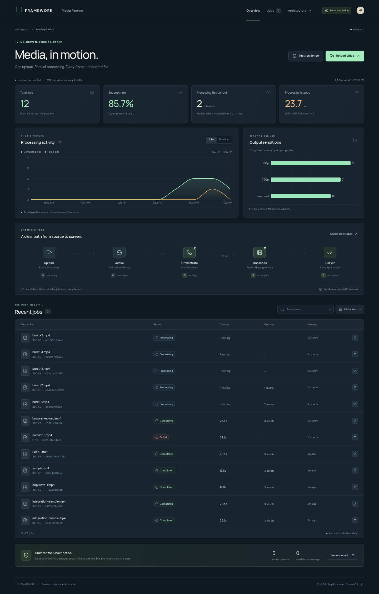
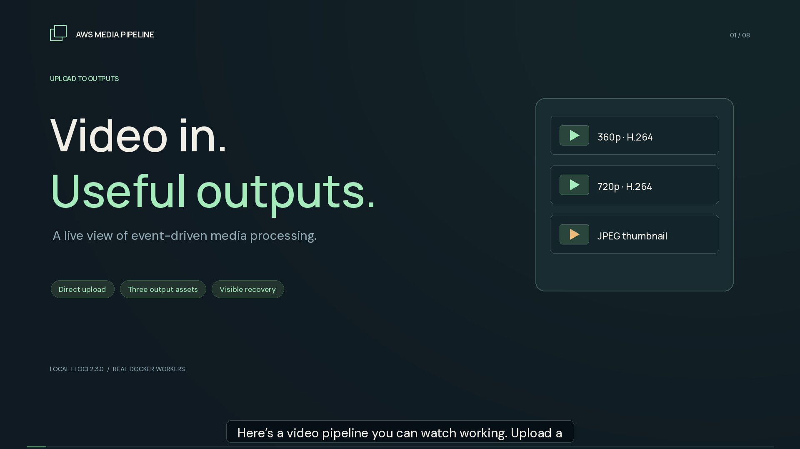
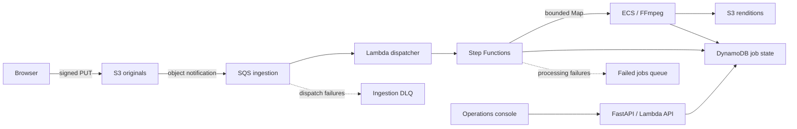
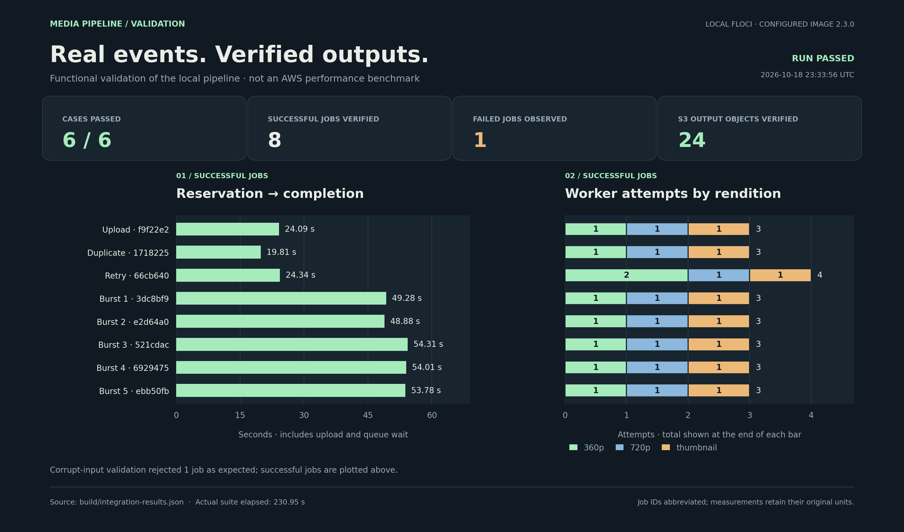

# AWS Media Pipeline

[](https://github.com/rohansikder/aws-media-pipeline/actions/workflows/ci.yml)

An event-driven video processing platform with a live operations console. Upload a video, generate two H.264 renditions and a thumbnail, and follow the work through S3, SQS, Lambda, Step Functions, ECS, and DynamoDB.

The local environment runs AWS-compatible APIs through [Floci 2.3.0](https://github.com/floci-io/floci), with real Lambda containers and real FFmpeg workers. A separate Terraform environment defines the AWS deployment, including private Fargate networking and IAM-protected API access.



## Video walkthrough

[](docs/demo/aws-media-pipeline-demo.mp4)

[Watch the 2:15 demonstration](docs/demo/aws-media-pipeline-demo.mp4) · [Captions](docs/demo/aws-media-pipeline-demo.srt)

The walkthrough follows real local uploads, output playback, retry recovery, and corrupt-media diagnostics, with an animated architecture diagram and recorded validation results.

## What it does

- Uploads video directly to S3 using a short-lived, create-only signed URL.
- Dispatches S3 notifications through SQS, with partial-batch failure reporting and a dispatch dead-letter queue.
- Uses a named Standard workflow to make repeated notifications converge on one execution.
- Processes 360p, 720p, and thumbnail renditions with bounded parallel ECS tasks.
- Publishes attempt-specific outputs and rejects stale workers before they can replace the current result.
- Records job state, rendition attempts, events, and useful failure diagnostics in DynamoDB.
- Shows live workflow progress, output previews, latency, throughput, retries, and queue depth in a React console.
- Includes reproducible scenarios for duplicate events, a transient worker failure, corrupt media, burst traffic, and dispatch failure.



## Run locally

Prerequisites: Docker Engine with Compose and a working socket, Python 3.12, Node.js 22+, Terraform 1.10+, and `make`. Validated on Linux x86-64; the packaged Lambda bundle targets that architecture. Other hosts need compatible Docker emulation. Allow several minutes for the first Docker image and provider downloads. The stack binds its APIs to localhost; it does not deploy resources to your AWS account.

```bash
git clone https://github.com/rohansikder/aws-media-pipeline.git
cd aws-media-pipeline
make setup
make up
make serve
```

Open **http://localhost:8000**. Upload an MP4, MOV, or WebM video, or use a reliability scenario. Sources are limited to **100 MiB and 120 seconds**. Workers fit each rendition within its target resolution without upscaling smaller sources.

For frontend development, keep `make serve` running and run `make dev` in another terminal. Vite proxies `/api` to port 8000.

```bash
make test          # isolated unit tests
make lint          # Python lint and Terraform formatting
make integration   # builds/provisions local stack and runs real end-to-end scenarios
make down          # stop Floci; retain its data volume
make clean         # destroy local resources and remove local data
```

`make clean` deletes this local environment's stored videos and job history. Terraform state and build artifacts are ignored by Git.

## Reliability you can observe

| Scenario | Expected behaviour |
| --- | --- |
| Duplicate notification | One workflow execution and one set of renditions |
| Transient worker failure | First 360p attempt fails; a later attempt succeeds |
| Corrupt video | Workflow fails with diagnostics; failed-job notification is retained |
| Burst of five jobs | Actual concurrent jobs and queue activity appear in the console |
| Malformed intake message | Dispatch retries exhaust and the message reaches the ingestion DLQ |

The ingestion message is acknowledged when a workflow starts. Later media-processing failures are tracked by the workflow and the separate failed-jobs queue. A dispatch DLQ does not represent the state of an entire processing job.

Metrics in the console come from actual retained job records and approximate SQS queue counts. Percentiles use successful jobs only; these small local runs are functional evidence rather than AWS performance benchmarks.

The recorded local run passed **all six scenarios**, verifying **24 output files across nine jobs**, including the deliberately rejected corrupt upload. See the [raw results and methodology](docs/results/README.md).



## Infrastructure and operations

- [Architecture and design decisions](docs/architecture.md)
- [Operations and failure recovery](docs/operations.md)
- [AWS deployment guide](docs/aws-deployment.md)
- [Recorded validation results](docs/results/README.md)

The AWS configuration uses separate API, dispatcher, controller, worker, execution, and workflow roles; private S3 buckets; default encryption; an isolated worker subnet; service endpoints; log retention; and CloudWatch alarms. Its HTTP API requires AWS IAM authentication, and scenario injection is disabled by default.

Floci does not establish AWS IAM, networking, capacity, or cost behaviour. Local IAM enforcement is deliberately disabled, ECS tasks use local placeholder credentials, and running Step Functions executions are aborted when the emulator restarts. The AWS configuration must be validated in an AWS account before treating this as a production deployment.

## Repository map

```text
services/pipeline/       API, ingestion, workflow lifecycle, FFmpeg worker
web/                    React + TypeScript operations console
infra/modules/pipeline/ Shared Terraform infrastructure
infra/environments/     Local emulator and real AWS configurations
scripts/                Packaging, local startup, integration harness, signed API client
tests/                  Isolated correctness and media-safety tests
docs/                   Architecture, operations, deployment, measured results
```

GitHub Actions runs Python checks, the web build, both Terraform validations, and the complete local integration suite. No AWS account credentials are required for CI.

Licensed under [MIT](LICENSE). The generated test-pattern video in `services/pipeline/assets/` is a synthetic fixture created with FFmpeg.
