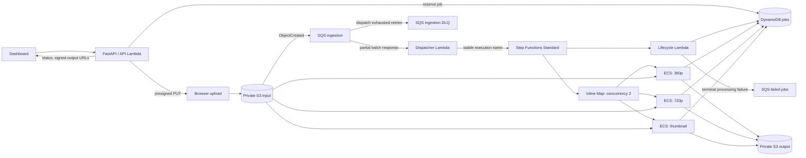

# Architecture and correctness

The platform turns an uploaded video into two MP4 renditions and a JPEG thumbnail. Floci 2.3.0 supplies local AWS-compatible APIs; Lambda handlers and ECS workers execute in real Docker containers. Terraform defines the resources shared by the local and AWS environments.



The dashboard uses the local FastAPI process during development. On AWS, the same API handler runs behind an HTTP API protected by `AWS_IAM` authorization. AWS requests require SigV4 signatures and an identity with `execute-api:Invoke`; the endpoint is not an anonymous upload service. A locally served dashboard can also use AWS through its FastAPI process and configured AWS SDK credentials. CORS limits browser origins but does not replace authorization.

## Data flow

1. The API creates a conditional DynamoDB job reservation and returns a short-lived presigned upload URL. The browser sends bytes directly to S3 under `uploads/<jobId>/<filename>`. The signed `If-None-Match: *` header conditionally creates the object, preventing that upload URL from overwriting an existing source.
2. S3 sends an `ObjectCreated` notification to SQS. The queue policy limits sends to the input bucket and deployment account. The dispatcher ignores S3 configuration test events and validates the bucket, object key, and existing reservation.
3. The dispatcher starts a Standard workflow named `job-<jobId>` with a stable JSON payload. AWS's execution-name idempotency prevents duplicate notifications from starting multiple workflows for that job. A running execution with identical name and input returns the existing execution; a completed execution with that name cannot be restarted while AWS retains the name. The dispatcher acknowledges either successful dispatch or an already-existing execution.
4. The lifecycle handler records `RUNNING`. An inline Map launches `360p`, `720p`, and `thumbnail` container tasks with at most two renditions running concurrently **within each workflow**. This is not a global concurrency limit across jobs.
5. Workers download the source, validate it, run FFmpeg, upload their result, and atomically update their own attempt counters, output entry, and events in DynamoDB. Bytes remain in S3; SQS and Step Functions carry references.
6. The lifecycle handler records `SUCCEEDED` only after all three outputs exist in the job record. If a task exhausts its retries, the Map catches the failure, records `FAILED`, sends a failed-job message, and fails the workflow.

The input to a workflow is deliberately small:

```json
{
  "jobId": "8cb76fed1b494e929498465a88b286ef",
  "objectKey": "uploads/8cb76fed1b494e929498465a88b286ef/clip.mp4",
  "bucket": "media-local-input"
}
```

The lifecycle Lambda receives `{ "action": "start|complete|fail", "job": <workflow input>, "error": <optional failure> }` and returns the job input. Each container receives `JOB_ID`, `OBJECT_KEY`, `SOURCE_BUCKET`, `OUTPUT_BUCKET`, `JOBS_TABLE`, and `RENDITION`.

## Retry and failure boundaries

The ingestion message is deleted after a workflow has started, rather than after the video finishes. The ingestion DLQ therefore contains notifications that could not be **dispatched**. It is distinct from the failed-jobs queue, which records workflows that exhausted processing retries.

The dispatcher uses `ReportBatchItemFailures`: only unsuccessful SQS messages are retried. After three failed receives, a message moves to the ingestion DLQ. Local visibility is 20 seconds for short demonstrations, with a 10-second dispatcher timeout. AWS uses a 180-second visibility timeout and 30-second dispatcher timeout, following the six-times-timeout recommendation with no batching window.

Each rendition has a 180-second task timeout and up to two retries after its first attempt, with exponential backoff and full jitter. A failed Map stops its active sibling tasks; a cancelled or timed-out `.sync` task requests that ECS stop the underlying task. The full workflow has a 30-minute timeout. Task exits and retries appear in Step Functions history and structured logs.

Output keys identify an attempt: `jobs/<jobId>/<rendition>/attempt-<N>.<extension>`. After uploading, a worker publishes its output pointer in DynamoDB only if its attempt is still the current attempt for that rendition and the job is still `RUNNING`. A delayed older attempt therefore cannot replace a newer result or publish after a terminal job transition. Retries can still execute and upload more than once; unreferenced attempt objects may remain in S3. The job record selects one current output per rendition rather than claiming exactly-once execution. Retention or cleanup of unused attempt objects is an operational extension.

A workflow-level timeout or an explicit `StopExecution` occurs outside the normal task/Map failure catch path. In those cases the lifecycle handler may not run, leaving the DynamoDB job `RUNNING` even though Step Functions is terminal. This version has no automatic reconciliation service. Operators must compare the job with execution status; an EventBridge execution-status handler or periodic reconciler would be the next step for keeping these views aligned. AWS workflow durability does not automatically synchronize application records.

The application signs conditional creation into upload requests, so normal uploads cannot replace an existing source. The workflow still identifies a bucket and key rather than a pinned version ID: a separately authorized writer could replace that object outside the application's upload contract. A stronger ingestion contract would bind the notification's version ID into the execution and have workers read that exact version.

The retry scenario deliberately fails the first `360p` worker attempt. It exercises the real container exit, Step Functions retry, new container launch, and eventual successful output. Corrupt-media and malformed-notification scenarios exercise different failure boundaries. Scenario routes are enabled locally and disabled in the AWS API configuration.

## State and observability

DynamoDB stores job status, timestamps, rendition outputs, per-rendition attempts, and a bounded demonstration event history. `jobId` is the partition key. Conditional writes prevent a reservation from being replaced and guard updates to existing jobs. Per-rendition updates avoid writing an entire stale job over another worker's result.

The dashboard derives its operational charts from recorded jobs and queue attributes. CloudWatch receives custom `MediaPipeline` metrics such as `JobsDispatched`, `JobsSucceeded`, `JobsFailed`, and job duration. Terraform supplies log retention, a workflow-outcome dashboard, an ingestion-DLQ alarm, and a terminal-failure alarm. These alarms have no notification destination configured; operators can inspect their state or attach an alerting channel.

AWS supplies native SQS metrics. Floci support for a service API does not guarantee identical automatic metrics: local queue depth is read directly through `GetQueueAttributes`. Local timing measures this computer and Docker runtime; it is not an AWS capacity or pricing benchmark.

The API's job listing is a bounded scan of up to 1,000 records. Long-lived deployments should introduce a time-indexed query path and separate append-only event storage before job/event history grows large. There is no claim of unlimited retention or production-scale pagination.

## IAM and private networking

Each AWS component has a separate role:

| Identity | Permissions |
| --- | --- |
| API Lambda | Reserve/read/update jobs, sign input uploads and output reads, inspect the queues and workflow history |
| Dispatcher Lambda | Consume the ingestion queue, validate reservations, start this state machine |
| Lifecycle Lambda | Update job state, publish custom metrics, send to the failed-jobs queue |
| ECS task execution role | Pull the worker image from this ECR repository and send worker logs |
| ECS worker task role | Read the input bucket, write the output bucket, update this job table, publish metrics in `MediaPipeline` |
| Step Functions role | Invoke the lifecycle handler, run the worker task definition in this cluster, pass only the two task roles, monitor/stop its tasks |

Roles scope resource-capable APIs to this deployment's resources. APIs that require `Resource: "*"`, such as ECR authorization and CloudWatch metric publication, are separated; metric publication is additionally limited to the application namespace. S3 public access is blocked, server-side encryption and versioning are enabled, and real AWS DynamoDB point-in-time recovery is enabled. AWS uses the normal credential chain, with no access keys stored in Terraform.

AWS ECS tasks run without public IPs in one private subnet. The VPC has no internet gateway or NAT gateway. S3 and DynamoDB gateway endpoints provide data access; ECR API, ECR registry, CloudWatch Logs, and CloudWatch Monitoring interface endpoints provide image pulls and telemetry. Workers accept no inbound connections. Endpoint security groups admit TLS from the worker security group only. This is a single-AZ demonstration, rather than a multi-AZ availability design.

The four interface endpoints incur hourly AWS charges even when no videos are processing. Fargate execution, storage, logs, and API calls are also billable. Review the plan before deployment and remove resources after a demonstration. Real AWS buckets and the ECR repository are deliberately not configured for forced deletion of retained data.

## Local fidelity and deployment boundaries

| Concern | Floci 2.3.0 development environment | AWS environment |
| --- | --- | --- |
| APIs | Explicit Terraform/SDK endpoint overrides | Ordinary regional endpoints |
| Runtime | Real Docker Lambda and FFmpeg workers | Lambda and ECS Fargate |
| Credentials | Public test placeholders; IAM enforcement off | Separate IAM roles and SDK credential chain |
| ECS task identity | Local credentials passed in container overrides; task-role proxy disabled | ECS vends worker task-role credentials |
| Network | User-defined `media-pipeline` Docker network | Private subnet and AWS service endpoints |
| API access | Loopback FastAPI process; local API Gateway has no authorization | HTTP API requires IAM signatures; scenarios disabled |
| SQS Lambda concurrency | Floci persists `MaximumConcurrency` but dispatches serially per mapping | Maximum concurrency of two is enforced |
| Step Functions restart | Running executions become `ABORTED` after emulator restart | AWS manages workflow durability |

Floci's default wait/retry ceiling is 30 seconds; the development Compose file raises it to 120 seconds. Workflow retries here use short delays. Container runtimes need the Docker socket, and container SDK endpoints use `http://floci:4566`, while browser upload URLs use `http://localhost:4566`.

Floci stores local service state through the configured volume, but it does not resume a running Step Functions execution after the emulator restarts. A job may consequently still say `RUNNING` in DynamoDB after its execution was aborted. There is no background reconciliation service here; operators should inspect execution status and create a fresh job when demonstrating recovery from an emulator restart. This differs from testing a failed worker, which is handled by the workflow's retry policy.

The Terraform module is shared by `infra/environments/local` and `infra/environments/aws`. Local startup applies only to Floci. The AWS environment is supplied for review and deployment through an operator's AWS account; a successful local run does not establish that the stack has been deployed to AWS. Validate IAM denials, endpoint connectivity, execution cancellation, retries, and teardown in an actual AWS integration run before making that claim.
