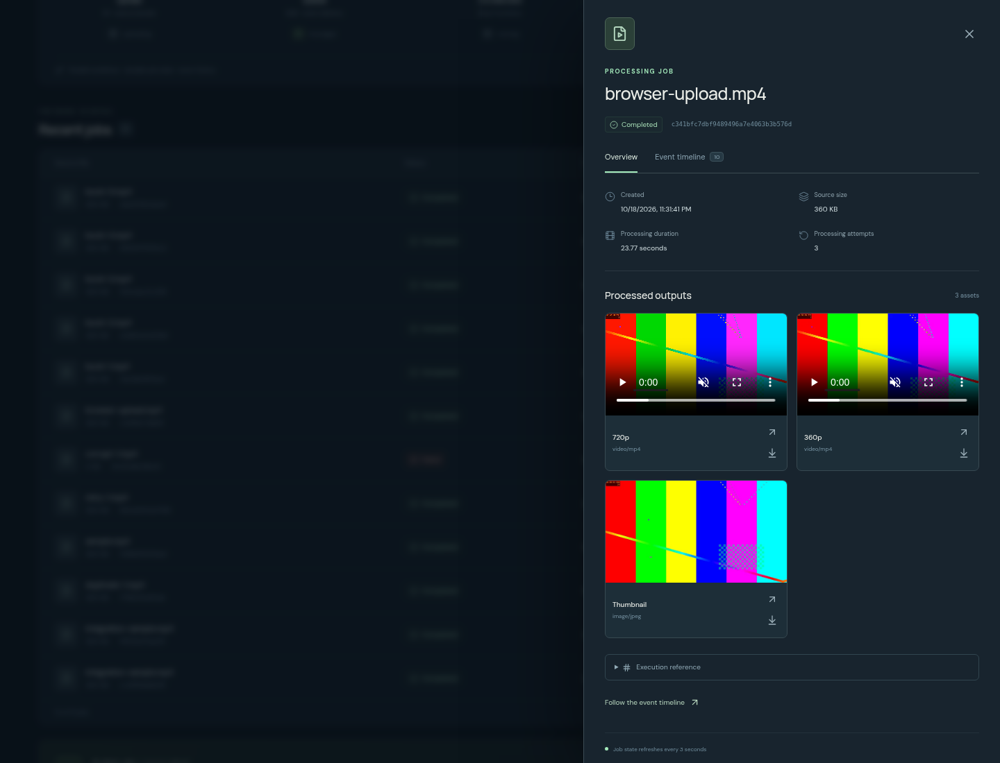
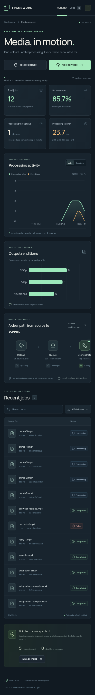

# Validation evidence

The recorded integration run completed on **18 October 2026 at 23:33:56 UTC**, using Floci 2.3.0, real Python Lambda containers, and real ECS/FFmpeg Docker tasks. Its fixture is a two-second synthetic 1280×720 video with audio.

All **six cases passed** in **230.951 seconds** of harness wall-clock time. The suite followed nine jobs: eight successful jobs and one intentionally failed corrupt-media job. It verified **24 output files**, including container signatures, S3 content types/metadata, codecs, dimensions, and duration with `ffprobe`. It observed 31 rendition attempts, including deliberate failures and retries.

| Case | Result | Harness elapsed seconds |
| --- | --- | ---: |
| Signed upload and overwrite rejection | Passed | 24.408 |
| Duplicate notification | Passed | 20.343 |
| Transient worker failure and recovery | Passed | 25.339 |
| Corrupt-media rejection | Passed | 40.275 |
| Burst of five jobs | Passed | 55.638 |
| Malformed dispatch reaching DLQ | Passed | 64.206 |

Case time includes polling and output verification. The dispatch case includes queue visibility/redrive waits; it is not media-processing latency. Job processing time is measured separately from workflow start to terminal status. The plot's end-to-end durations run from reservation to completion. These are local functional measurements, not AWS performance or availability benchmarks.


## Provenance

[integration-results.json](integration-results.json) contains timestamps, fixture SHA-256, checked object hashes, attempt counts, execution history summaries, queue policy, and observations. The full local run records application revision `ec9e9d916fe9f0aebf7049857c09e6ab774f59d5`. Later dispatcher recovery and web dependency updates have additional checks; the GitHub Actions integration job builds and tests the repository revision associated with each run.

[browser-verification.json](browser-verification.json) records the separate real browser upload, output playback, stable playback across polling, download, timeline, and desktop/mobile checks. These browser jobs and an earlier diagnostic upload remain visible in the dashboard, so screenshot totals exceed the nine jobs belonging to the recorded integration run.

[api-gateway-smoke.json](api-gateway-smoke.json) records a separate check through Floci's HTTP API Gateway and actual API Lambda. The hostname is supplied as a local routing header; no live AWS API Gateway deployment was used.

[restart-verification.json](restart-verification.json) records a separate graceful Floci restart with WAL storage: 12 job records, 33 output references, nine terminal execution states, and all 24 integration output hashes were retained. [post-restart-duplicate-check.json](post-restart-duplicate-check.json) confirms that a fresh job completed after restart and repeated events still produced one execution. This does not test resuming an in-flight execution.

The isolated Python suite currently contains **58 passing tests**. The React/TypeScript build, Terraform validation for both environments, Python lint, and workflow syntax checks also pass locally. GitHub Actions reruns these checks and the full event-path integration independently.

## Console screenshots






## Reproduce

```bash
make setup
make integration
.venv/bin/pip install -e '.[reports]'
.venv/bin/python scripts/render_results.py
```

The suite writes a new report to `build/integration-results.json`; it does not replace the committed report automatically. The plotting script uses the new report to render `docs/results/validation.png` and `validation.svg`. Each run adds real jobs to the local environment and retains diagnostic messages. A failure produces a nonzero exit code and a report containing the failed checks. GitHub Actions uploads that report even if integration fails.
